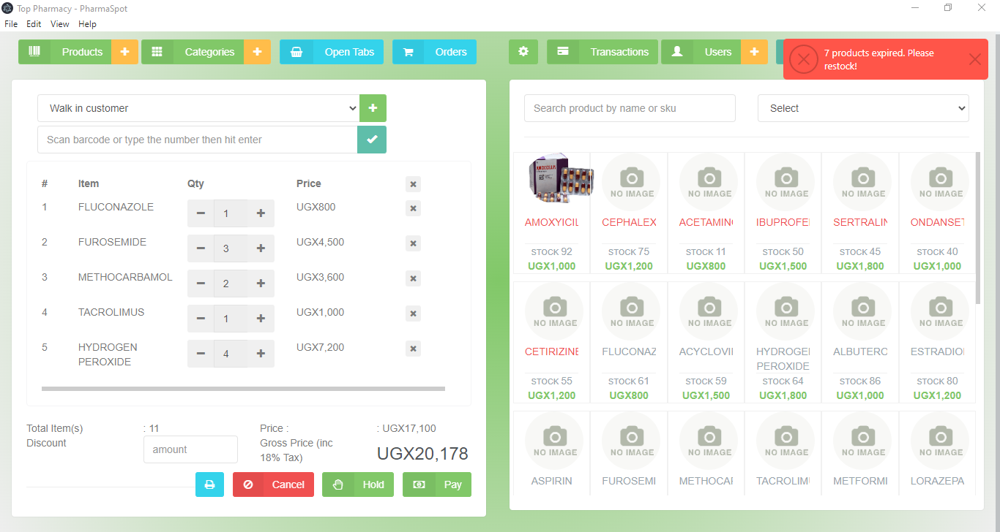
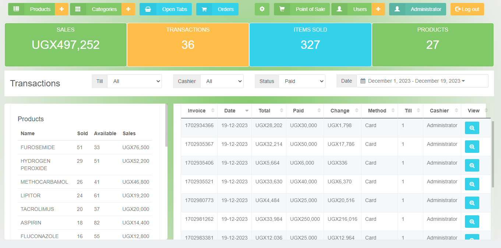

# Multi Medicos — Pharmacy Management System

Multi Medicos is an offline Windows desktop application for day-to-day pharmacy operations, with workflows tailored to Pakistani medical stores. It is a maintained customization of the open-source PharmaSpot project and uses PKR throughout the application.

Version: **1.5.5**

## Features

- **Secure access:** first-run owner creation, login/logout, additional users, role-based permissions, bcrypt password hashes, expiring sessions, and replacement of legacy default credentials.
- **Medicines and inventory:** medicine and category management, barcode/SKU and name search, quick-add during purchasing, stock levels, batch and expiry tracking, stock adjustments, bonus stock, and FEFO batch allocation.
- **Point of sale:** cash, credit/Khata, and mixed-payment sales; registered-customer selection; held orders; invoice/receipt printing; idempotent transaction recording; and atomic stock deduction.
- **Customers and Khata:** customer records, opening and outstanding balances, statements, credit limits, collections, payment allocation, and payment history.
- **Suppliers and purchases:** simplified supplier forms, purchase drafts and receiving, paid/partial/unpaid purchases, supplier statements and payments, returns, and inventory updates.
- **Accounting and reports:** expenses, sales/purchase history, dashboard summaries, trial balance, double-entry journals, and internal cashbook records. Ledger and Cashbook pages are intentionally hidden while their accounting logic remains active.
- **Data safety:** durable SQLite settings, database transactions and rollback, duplicate-sale protection, integrity-checked backups, staged restore on restart, and preservation of the previous data folder during restore.

## Technology stack

- Electron **43.8.4** (resolved release runtime) and Electron Forge **8.0.1**
- Node.js (Electron-bundled `node:sqlite`) and Express **5.2.1**
- HTML, CSS, JavaScript, jQuery **3.6.3**, and Bootstrap
- SQLite through `DatabaseSync`; no database server or native SQLite package
- Jest **29.7.0** plus isolated Node/Electron integration scripts
- Squirrel.Windows installer for Windows 10/11 x64

See [Architecture](docs/ARCHITECTURE.md) for the request, data, accounting, backup, and packaging flows.

## Screenshots

| Point of sale | Transactions |
| --- | --- |
|  |  |

| Payment | Receipt |
| --- | --- |
|  |  |

## Project structure

```text
.
├── start.js                 Electron main process and window lifecycle
├── server.js                Loopback-only Express API startup
├── index.html               Desktop UI and dialogs
├── renderer.js              Renderer entry point
├── api/                     Routes, business rules, SQLite schema/access
├── assets/                  Frontend JS/CSS, plugins, fonts, and icons
├── public/                  Runtime logo and default product image
├── installers/              Squirrel events and restart-safe restore
├── scripts/                 Isolated integration, UI, backup, and smoke tests
├── tests/                   Jest tests
├── screenshots/             Real application screenshots
├── docs/                    Architecture, setup, Windows, and troubleshooting
├── forge.config.js          Electron Forge/Squirrel packaging
└── package.json             Dependencies and development commands
```

## System requirements

For development:

- Windows 10 or 11 x64
- Node.js **24.x** (24.17.0 was used for this release verification)
- npm **11.x** (included with current Node.js 24 installers)
- Git
- Internet access only to install npm dependencies

End users need only Windows 10/11 x64 and the installer. Multi Medicos runs offline and does not require Node.js, npm, Git, or a SQLite server after installation.

## Clone the project

```bash
git clone https://github.com/SAADSAEED007/muti-medicos.git
cd muti-medicos
```

## Install dependencies

```bash
npm ci
```

The committed `package-lock.json` supports reproducible npm installs. npm is the verified release workflow.

## Run in development mode

```bash
npm start
```

Electron starts the local Express API automatically and then opens the desktop window; no second terminal or separate backend command is needed.

## Build the Windows installer

```bash
npm ci
npm run make:win
```

The Squirrel installer is written to `out/make/squirrel.windows/x64/` as `Multi-Medicos-<version>-Setup.exe`. The `out/` directory is generated and intentionally ignored. Installer builds are unsigned unless a trusted code-signing identity is configured.

## Database setup and persistence

The application creates this database when it first starts:

```text
%APPDATA%\PharmaSpot\server\databases\pharmacy.sqlite
```

The `PharmaSpot` data-folder name is intentional: keeping the original package identity allows Multi Medicos updates to reuse existing owner accounts and pharmacy records. A fresh installation creates an empty schema and shows **Create Owner Account**. It does not ship a development database, demo medicines, or preset credentials.

Use **File → Backup** and **File → Restore** inside the application. Restore verifies and stages a backup, restarts the app, and saves the previous live folder beside `%APPDATA%\PharmaSpot` before replacing data. Never test with a real client database; use `TEST_APPDATA` or the isolated scripts in `scripts/`.

## First-time application setup

1. Run `npm start` or launch the installed application.
2. Enter the desired owner username.
3. Enter a password of at least 12 characters.
4. Select **Create Owner Account**.
5. Add medicines and suppliers, then receive purchases to establish stock.

## Running tests

```bash
npm test -- --runInBand
node scripts/test-users.js
node scripts/test-sales.js
node scripts/test-sale-crash.js
node scripts/test-simple-supplier-purchase.js
node scripts/test-transaction-history.js
node scripts/test-enterprise-system.js
node scripts/test-offline-backup.js
node scripts/test-pending-restore.js
```

Jest covers shared utility behavior. The isolated scripts cover authentication, sales and retry safety, purchasing, stock, Khata, transactions, accounting balance, backup, restore, and persistence using temporary data directories. Electron UI runners are also available in `scripts/`; see [Developer Setup](docs/DEVELOPER_SETUP.md) for their current verification status and commands.

## Common problems

- **`node:sqlite` is unavailable:** install Node.js 24 x64 and run `npm ci` again.
- **Electron will not start:** close orphan Electron processes, verify port 3210 is not reserved, and retry. The app can select a free loopback port when the default is occupied.
- **Dependency or native-module errors:** remove only the generated `node_modules` folder, then run `npm ci`. Do not delete application data.
- **Owner setup does not appear:** you may be using an existing `%APPDATA%\PharmaSpot` profile. Do not delete it if it may contain pharmacy data; see the troubleshooting guide.
- **SQLite cannot initialize:** check Windows permissions and free disk space for `%APPDATA%\PharmaSpot`.
- **Packaging fails:** use Windows x64, Node.js 24, and a clean `npm ci`; check whether antivirus quarantined a generated Squirrel file.
- **SmartScreen warns on install:** this private build is unsigned. Verify the installer checksum and source before proceeding; do not disable Windows security.

More detail is in [Troubleshooting](docs/TROUBLESHOOTING.md) and [Windows Installation](docs/WINDOWS-INSTALLATION.md).

## Contributing

Create a focused branch and avoid rewriting working inventory, accounting, or persistence logic:

```bash
git switch -c fix/issue-name
```

Reproduce the issue with test data, add or update a test, run the relevant checks, push the branch, and open a pull request against `main`. See [CONTRIBUTING.md](CONTRIBUTING.md).

## License and credits

This repository preserves the PharmaSpot MIT license and original copyright notice in [LICENSE](LICENSE). Multi Medicos is a substantial customization maintained by Muhammad Saad Saeed. Upstream code and attribution remain credited; the customization does not claim authorship of all original PharmaSpot source files.

## Maintainer

Muhammad Saad Saeed<br>
GitHub: [SAADSAEED007](https://github.com/SAADSAEED007)
